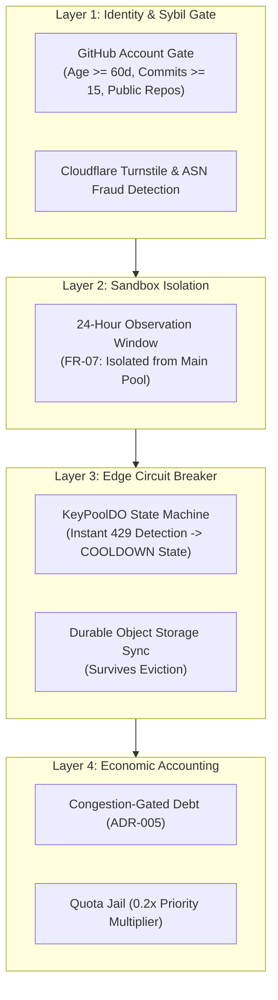
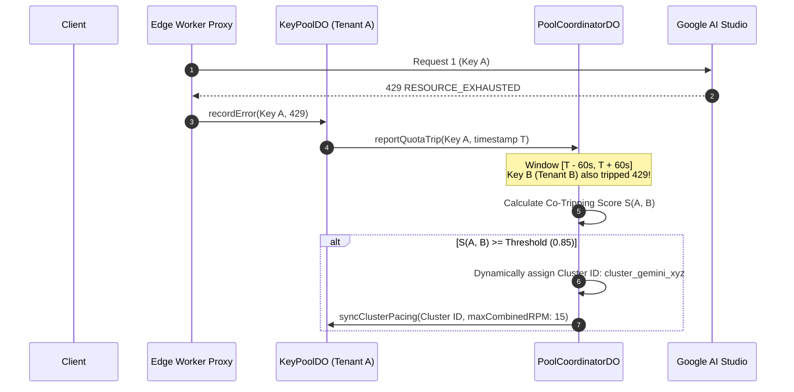

# ADR-006: Modern Google AI Studio Scoped Tokens (`AQ.`) & Runtime Quota Co-Tripping Detection

**Status:** Accepted (Backlog / Future Architectural Evolution)  
**Date:** 2026-10-21  
**Deciders:** System Architect, Security Sentinel  
**Invariants Affected:** Upstream Quota Isolation, Anti-Sybil Defense, Key Registration State Machine  
**Related Documents:**
- [`docs/specs/gcp_probe.md`](file:///home/akshit/Projects/Key%20Collective/docs/specs/gcp_probe.md)
- [`docs/threat_model_v3_5.md`](file:///home/akshit/Projects/Key%20Collective/docs/threat_model_v3_5.md)
- [`docs/tech_debt_and_smells.md`](file:///home/akshit/Projects/Key%20Collective/docs/tech_debt_and_smells.md)
- [`docs/adr/005-contribution-capacity-credit.md`](file:///home/akshit/Projects/Key%20Collective/docs/adr/005-contribution-capacity-credit.md)

---

## 1. Context & Problem Statement

### 1.1 The Legacy Invariant: Static GCP Project Hash Deduplication
In Key Collective v0.3 – v3.5, the platform implemented a pre-registration anti-collusion gate for Google Cloud keys:
1. When a contributor registered an API key (historically matching `AIzaSy[A-Za-z0-9_-]{35}`), the edge worker dispatched an out-of-band probe to disabled Google Cloud APIs (such as Google Translate v2 or YouTube Data v3).
2. The probe deliberately provoked an HTTP 403 `PERMISSION_DENIED` response containing Google RPC `ErrorInfo`:
   ```json
   {
     "error": {
       "code": 403,
       "status": "PERMISSION_DENIED",
       "details": [
         {
           "@type": "type.googleapis.com/google.rpc.ErrorInfo",
           "reason": "API_KEY_SERVICE_BLOCKED",
           "metadata": { "consumer": "projects/108374928174" }
         }
       ]
     }
   }
   ```
3. Key Collective extracted `projects/<NUM>`, calculated `SHA-256(project_number + PEPPER)`, and persisted it to the D1 table `project_hash_registry`.
4. This prevented malicious or unknowing contributors from registering multiple keys tied to the same GCP project (which share the same 15 RPM / 1M TPM free-tier quota ceiling), enforcing `UNIQUE(provider, provider_project_hash)`. It also backed the 30-minute key rotation grace window (`ROTATING`) and 14-day anti-cycling tombstone (`TOMBSTONED`).

### 1.2 The Upstream Ecosystem Shift: Scoped AI Studio Tokens (`AQ...`)
In late 2024 / 2025, Google AI Studio shifted the structure of issued keys:
- Legacy format: `AIzaSy...` (39 characters, standard GCP project API key).
- Modern format: `AQ.[A-Za-z0-9_-]{51}` (54 characters, tightly scoped OAuth2 / service authorization token).

**Key Architectural Properties of `AQ.` Tokens:**
1. **Scope Restriction:** `AQ.` tokens are strictly bounded to `generativelanguage.googleapis.com`.
2. **Side-Channel Elimination:** Probes to Translation v2, YouTube v3, or Cloud Resource Manager return generic HTTP 400 `INVALID_ARGUMENT` or HTTP 401 `CREDENTIALS_MISSING` with **zero `consumer` or project metadata**.
3. **No Upstream Identity Leaks:** The token does not reveal GCP project IDs, project numbers, or billing account linkages in any client-accessible API response headers or bodies.
4. **Provider Parity:** Other supported providers (Groq, Cerebras, SambaNova, Mistral, OpenRouter) also use opaque bearer tokens without public project identifiers.

### 1.3 The Emerging Security Risk
Because `AQ.` tokens return `null` from `forceErrorGcpProbe`, `provider_project_hash` in D1 remains `NULL`:
- **Sybil Quota Stacking:** A contributor can generate multiple `AQ.` keys from the *same* underlying Google AI Studio project / Google account and submit them across multiple Key Collective tenants (or rotate a key from a completely different project into an existing slot without triggering static `409 project_mismatch`).
- **Cascading Exhaustion:** Multiple keys sharing the same upstream project quota bucket appear as independent capacity units in the pool. When simultaneous traffic routes through them, the upstream project bucket is rapidly exhausted, triggering simultaneous HTTP 429 `RESOURCE_EXHAUSTED` responses and degrading pool reliability.

---

## 2. Decision & Architectural Invariants

### 2.1 Invariant: Retain Existing Project Hash Logic (Zero Regression)
We explicitly retain the existing `project_hash_registry` table, D1 schema constraints, and GCP probe mechanisms:
- Legacy `AIzaSy...` keys continue to be probed, hashed, and deduplicated deterministically.
- Database schemas and integration tests (`test/integration/commons/project_hash.test.ts`, `anti_cycling.test.ts`) remain fully supported and green.
- `provider_project_hash` remains nullable for modern scoped tokens (`AQ...`) and non-Google providers.

### 2.2 Shift from Static Pre-Registration Probing to Runtime Telemetric Cluster Inference
Static pre-registration inspection is fundamentally unviable against modern scoped bearer tokens across all major AI providers. Therefore, Key Collective will transition future quota defense to **Runtime Telemetric Quota Co-Tripping Detection** in `PoolCoordinatorDO`.

---

## 3. Current Defense-in-Depth Model (Production Active)

Even in the absence of static GCP project hashing for `AQ.` tokens, Key Collective enforces four active layers of defense:



1. **Layer 1: Anti-Sybil Gate (`src/auth/sybil/`):**
   - Developer-tier registration requires linking an authenticated GitHub account with verified age ($\ge 60$ days), activity ($\ge 15$ commits), and clean IP/ASN reputation. D1 enforces `UNIQUE(github_user_id)`.
   - Programmatic generation of dozens of fake developer accounts is economically and technically disincentivized.

2. **Layer 2: 24-Hour Observation Window (`FR-07`):**
   - All newly registered keys are quarantined in the `OBSERVATION` tier for 24 hours.
   - Keys that fail or exhaust during this burn-in period never impact the core community pool.

3. **Layer 3: Edge Circuit Breaker (`KeyPoolDO`):**
   - The moment any key receives an upstream HTTP 429 `RESOURCE_EXHAUSTED`, the Durable Object instantly trips the key into `COOLDOWN` (exponential backoff up to 1 hour).
   - Hot state persists immediately to `this.ctx.storage`, preventing traffic from hammering a depleted quota bucket.

4. **Layer 4: Congestion-Gated Debt & Quota Jail (`FR-03`, `ADR-005`):**
   - If a tenant's keys frequently fail or cause upstream throttling, their capacity credit is penalized.
   - The key is placed in Quota Jail (0.2x priority multiplier), isolating the rest of the pool from bad actors.

---

## 4. Proposed Future Architecture: Runtime Quota Co-Tripping Detection

### 4.1 Concept: Telemetric Cluster Inference
Rather than guessing upstream accounts via brittle error strings, `PoolCoordinatorDO` will observe runtime failure correlation.

If two distinct keys $K_A$ and $K_B$ belonging to provider `gemini` experience simultaneous 429 `RESOURCE_EXHAUSTED` events under conditions where neither individual key exceeded its theoretical RPM/TPM pacing budget, the probability that $K_A$ and $K_B$ share an underlying upstream quota pool approaches unity.

### 4.2 Mathematical Model & Algorithm



#### Co-Tripping Pearson Correlation:
For each 5-minute sliding window partitioned into 10-second buckets $t \in [1..30]$:
$$X_i(t) = \begin{cases} 1 & \text{if key } i \text{ received 429 in bucket } t \\ 0 & \text{otherwise} \end{cases}$$

The correlation between keys $i$ and $j$:
$$r_{ij} = \frac{\sum_{t=1}^{N} (X_i(t) - \bar{X}_i)(X_j(t) - \bar{X}_j)}{\sqrt{\sum_{t=1}^{N} (X_i(t) - \bar{X}_i)^2 \sum_{t=1}^{N} (X_j(t) - \bar{X}_j)^2}}$$

### 4.3 Policy Enforcement on Inferred Clusters
1. **Dynamic Cluster Pacing:** When $r_{ij} \ge 0.85$ over at least 3 distinct tripping windows, keys $i$ and $j$ are assigned to a virtual `QuotaCluster`.
2. **Unified RPM Token Bucket:** The coordinator enforces that the *combined* dispatch rate of all keys in `QuotaCluster` does not exceed 15 RPM.
3. **Capacity Credit Neutralization:** The contributing tenants receive capacity credits scaled by $\frac{1}{|QuotaCluster|}$, eliminating the incentive to register multiple keys from the same account.
4. **Tenant Notification & Flagging:** D1 stores inferred cluster associations. The user dashboard displays an informational banner:
   > *"Keys K1 and K2 appear to share the same upstream Google AI Studio quota bucket. They have been grouped to prevent rate-limit penalties."*

---

## 5. Consequences & Trade-Offs

### 5.1 Benefits
- **Universal Provider Applicability:** Works identically for Google (`AQ.`), Groq, Cerebras, Mistral, and any future provider that does not expose project IDs.
- **Robust Against Obfuscation:** Attackers cannot bypass this check by tampering with token strings or headers because it observes physical upstream rate enforcement.
- **Preserves Invariants:** Zero changes required to existing cryptography (AES-256-GCM), tenant DO isolation (`env.KEY_POOL.idFromName`), or integer CU accounting.

### 5.2 Risks & Mitigations
- **Risk:** False positive clustering during widespread upstream provider outages (e.g., Google global 503/429 event).
  - *Mitigation:* Require that cluster inference only activates when *individual* pool dispatch rates were below the single-key RPM ceiling, and deactivate clustering if $>50\%$ of all keys across all tenants trip simultaneously (indicating a global provider outage rather than a shared quota bucket).
- **Risk:** Memory overhead in `PoolCoordinatorDO`.
  - *Mitigation:* Sliding window bitsets require only 30 bits (4 bytes) per key per 5-minute window. Memory footprint for 10,000 keys is $< 100\text{ KB}$.

---

## 6. Implementation Roadmap (Target: Phase 5 / v4.1)

1. **Telemetry Instrumentation:** Add `quota_trip_timestamp` to Workers Analytics Engine stream.
2. **Coordinator Bitset Tracking:** Implement sliding window bitset and correlation calculator in `src/pool/coordinator_do.ts`.
3. **Virtual Quota Clusters:** Add cluster routing table to `PoolCoordinatorDO` RPC dispatch.
4. **Dashboard Reporting:** Expose cluster associations in `/api/admin/clusters` and `/api/user/keys`.
